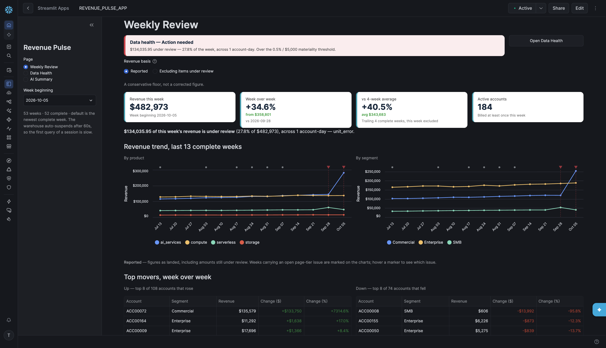
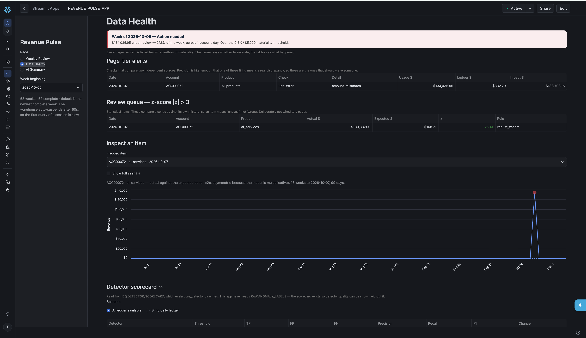
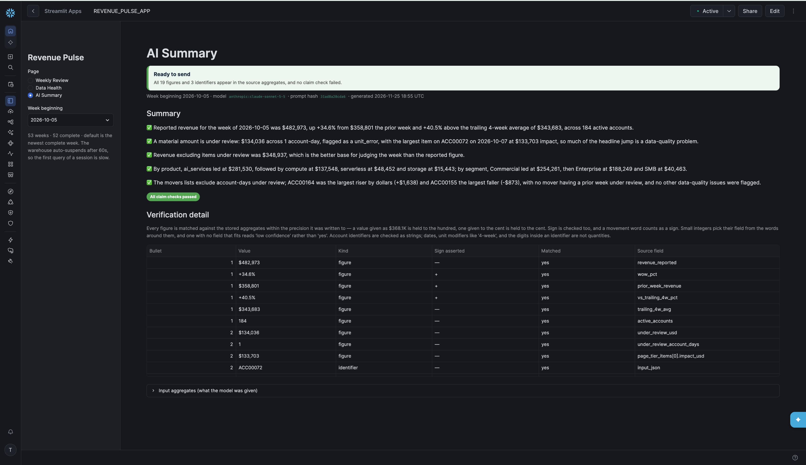

# Revenue Pulse

**A data pipeline that catches errors in revenue data — and measures how well
it actually catches them.**

### The problem

Software companies that bill by usage — cloud compute, API calls, storage —
calculate revenue from millions of metered events. When that pipeline breaks
quietly, the damage is invoices and board numbers built on wrong figures. A
meter reports in the wrong unit, a load runs twice, a day never arrives. Each
one looks like a normal business change until somebody checks.

### What this project does

It builds that pipeline end to end on Snowflake, then **deliberately breaks the
data in 33 known ways** and measures how many of them the pipeline's own checks
find. Because the faults were planted, there is an answer key — so every claim
about detection comes with a score rather than a demo.

### Why it is unusual

Most portfolio data projects end at a dashboard that looks right. This one
grades itself and publishes the grades, **including the places it fails**:

- The sophisticated statistical detector turns out to be **worthless** when a
  simple cross-check is available — documented with numbers rather than
  quietly dropped.
- An AI-written summary passed every numeric check while making a **false
  recommendation**, which is why a second layer of checks exists.
- Several of the bugs found along the way were in the *checking code itself*.

The reasoning behind every decision, including the mistakes and what they
taught, is in **[DECISIONS.md](DECISIONS.md)**.

### What it demonstrates

| | |
| --- | --- |
| **Data engineering** | Snowflake, dbt (11 models, 59 tests), incremental warehouse design, least-privilege roles, cost guardrails |
| **Analytics engineering** | revenue modelling, reconciliation against an independent source, partial-period handling, materiality thresholds |
| **Measurement** | precision/recall/F1 with a chance baseline, scenario analysis, a negative result reported honestly |
| **AI engineering** | Anthropic API, output verification, claim checking, model cost/latency comparison |
| **Engineering practice** | pinned dependencies, CI, regression tests for the tests, a written decision log |

Built with Python 3.11, Snowflake, dbt, Streamlit and the Anthropic API.
Everything below this line is the technical detail.

---

## What it looks like

**Weekly Review** — the business view: revenue, how it moved, which accounts
drove it. The red banner is the point of the project. Revenue looks up 34.6%
this week, but $134,036 of that — 27.8% — is sitting under review as a
suspected data error, so the headline is not yet a result anyone should act
on. The small red markers on the charts flag the same thing week by week.



**Data Health** — the two kinds of problem, kept deliberately apart. The top
table is for faults confirmed by comparing two independent records, which are
worth waking someone for. The second is a review queue of things that merely
look *unusual*, which are not. Selecting an item charts that account's daily
revenue against the range the model expected: here a unit-conversion error
reaches **1,200× its expected level**.



**AI Summary** — a written weekly brief, generated by an AI model and then
checked line by line against the figures it was given. It is marked "Ready to
send" only if every number traces back to the source data *and* the claims
about those numbers hold up. The table underneath shows exactly which field
each figure came from.



---

## Architecture

```
generator/          synthetic source data (seed=42) ──► RAW
  generate.py       200 accounts × 365 days × 4 products + 33 planted anomalies
  load.py           write_pandas → REVENUE_PULSE.RAW

dbt/                RAW ──► STAGING ──► MARTS ──► DQ
  staging/          typed, deduped, revenue computed        (3 views)
  marts/            fct_daily_revenue, fct_weekly_review    (2 tables)
  dq/               reconciliation, duplicates, late arrivals,
                    z-score detector v1 and v2, flagged anomalies (6 tables)
                    59 data tests + source freshness

eval/               the only code allowed to read RAW.ANOMALY_LABELS
  score_detector.py scores every detector, publishes DQ.DETECTOR_SCORECARD
  compare_models.py model comparison for the AI summary
  explain_mover.py  "was that move real?" — checks a mover against the labels

app/                Streamlit in Snowflake (get_active_session, no credentials)
  Weekly Review     KPIs, 13-week trend, top movers, data-health banner
  Data Health       page-tier alerts, review queue, series inspector, scorecard
  AI Summary        stored brief + live numeric and claim verification

scripts/            setup checks, summary generation, table-formatting guard
setup/              one-time bootstrap: database, schemas, X-Small warehouse,
                    5-credit resource monitor, role, key-pair service user
```

**Scale.** `USAGE_EVENTS` 239,548 rows · `LEDGER_REVENUE` 59,887 ·
`ACCOUNTS` 200 · `ANOMALY_LABELS` 33. A full `dbt build` is 70 nodes in ~10
seconds on an X-Small warehouse.

**Two structural rules the code enforces:**

- **The detector never reads the answer key.** `RAW.ANOMALY_LABELS` is readable
  only from `eval/`. The app shows detector quality by reading
  `DQ.DETECTOR_SCORECARD`, which `eval/` publishes — so the dashboard can
  report precision without ever touching a label.
- **The ledger is an independent witness.** `LEDGER_REVENUE` is booked from
  *clean* usage, before anomalies are injected, exactly as finance books from
  contracts rather than telemetry. That independence is what makes
  reconciliation a real signal rather than a tautology.

---

## The data is synthetic

All of it. There is no customer data in this repository and never was.

`generator/generate.py` builds the dataset from a single seeded RNG
(`seed=42`), so a rebuild is reproducible down to the value. It models weekday
seasonality, per-segment growth, ramp-up for newly onboarded accounts, faster
growth in AI products, lognormal noise, and churn — then plants **33 anomalies
of nine types** and records every one in `RAW.ANOMALY_LABELS`:

| Obvious | Subtle |
| --- | --- |
| spike (8–15×) · unit error (×1000) | mild spike (1.5–2×) |
| pipeline gap (1–2 days missing) | spike on a bottom-20% account |
| duplicate load · late arrival (3–7 days) | gradual drift (+20% over 21 days) |
| ledger mismatch (2–10%) | |

The subtle three exist because a detector that only catches 10× spikes looks
far better than it is.

Two consequences of a static synthetic snapshot, both deliberate and both
documented: source freshness starts warning 36 hours after a load (the check
working, not a regression), and Snowflake Cortex `AI_COMPLETE` is unavailable
on a trial account, so summary generation runs locally against the Anthropic
API with a Cortex code path kept behind a flag.

---

## Detector scorecard

> **Reading the numbers.** *Precision* is how much of what the check flagged
> was genuinely wrong — 1.000 means no false alarms. *Recall* is how much of
> what was wrong the check actually found. *F1* combines the two. A check can
> score perfectly on one and badly on the other, which is the whole reason
> both are reported.

Scored over **48,396 account-days**, against the **29 planted faults** that
fall inside detector v2's history window — the other 4 land too early in the
dataset for it to have a baseline. Published to `DQ.DETECTOR_SCORECARD`;
regenerate with `python eval/score_detector.py`.

### Scenario A — a daily ledger is available

| Detector | Precision | Recall | F1 |
| --- | --- | --- | --- |
| **Deterministic checks combined** | **1.000** | **0.971** | **0.986** |
| reconciliation (usage vs ledger) | 1.000 | 0.900 | 0.947 |
| late arrivals | 1.000 | 0.071 | 0.133 |
| duplicates | 1.000 | 0.057 | 0.108 |
| gap rule (zero after non-zero) | 1.000 | 0.057 | 0.108 |
| z-score v2 (\|z\|>4) | 0.197 | 0.200 | 0.199 |

**The headline result is negative, and it is the most interesting thing here.**
The cheap deterministic checks — essentially subtraction — find every fault
type at perfect precision, while the sophisticated statistical detector adds
*one* extra catch in exchange for **9,564 false alarms**. When you have a
second, independent record of what revenue should be, comparing the two beats
any amount of statistics.

The only thing missed is the first day of each gradual drift, where the drift
multiplier is exactly 1.0 — there is no fault present yet to find.

### Scenario B — no daily ledger (finance closes monthly)

The realistic case, and where the statistical detector earns its place.

| Threshold | Precision | Recall | Labels caught | Items/day |
| --- | --- | --- | --- | --- |
| \|z\|>3 | 0.027 | 0.343 | 24/29 | 2.9 |
| \|z\|>4 | 0.278 | 0.314 | 22/29 | 0.3 |
| \|z\|>5 | **0.786** | 0.314 | 22/29 | 0.1 |

Recall rises from 0.186 to 0.314 when the z-score is added, bringing in spikes,
unit errors and small-account spikes that nothing else can see once the ledger
is gone. `ledger_mismatch` becomes structurally undetectable — the usage side is
clean and only the booked figure moved — which is the strongest argument for
obtaining even a provisional daily feed.

### Detector v1 → v2

v1 was the specified estimator: median and MAD over the same weekday for 8
trailing weeks. It was badly calibrated, and the fix came from diagnosing *why*
rather than tuning the threshold:

| | v1 | v2 |
| --- | --- | --- |
| mean z | +0.659 | **+0.036** |
| sd z | 19.17 | **1.03** |
| % positive | 61.3% | 51.3% |
| flag rate at \|z\|>4 | 4.80% | **0.043%** |

Two causes, two changes. An 8-week-old median under-predicts a growing series,
so v2 scores `ln(value+1)` and shifts the baseline by a trend ratio. MAD over 8
points is unstable (5th percentile three times below its median), so v2
estimates spread from 13 weeks of *daily* residuals — valid only because the
expectation already conditions on weekday — floored by the product × segment
cohort. `sd z = 1.03` means a "4 sigma" event is finally rare.

**A chance baseline was necessary.** At a 4.8% flag rate, v1 "caught" a 21-day
drift 98% of the time by luck. Per-type comparison against chance separated
real detection from coincidence and showed v1's apparent recall on three
anomaly types was indistinguishable from random firing. Any recall number
without that baseline overstates the detector.

Full analysis, including the threshold sweep and the recommended alerting
design: [eval/RESULTS.md](eval/RESULTS.md).

---

## Model comparison — the weekly AI summary

The app writes a plain-English weekly brief with an AI model — and then checks
it. `scripts/generate_summary.py` sends the week's totals as structured data,
asks for five bullets using **only** numbers from that data, and stores the
brief alongside the exact input. Every figure is re-checked against that input
when the page loads, so a wrong number is caught rather than read.

Three runs of each model on the same week, to compare accuracy, speed and cost:

(week 2026-10-05, identical 2,548-token prompt —
`python eval/compare_models.py 2026-10-05 --runs 3`)

| Model | Verified | Latency | Tokens out | Cost/run | Price (in/out per MTok) |
| --- | --- | --- | --- | --- | --- |
| `claude-opus-5-5` | 3/3 | 4.98s | 533 | $0.0223 | $4 / $20 |
| `claude-sonnet-5-5` | 3/3 | **3.21s** | 362 | $0.0094 | $2 / $10 |
| `claude-haiku-5-5` | 3/3 | 5.85s | 1,255 | **$0.0009** | $0.10 / $0.50 |

All three are equally accurate on this task, so the choice is latency against
cost. **Sonnet 5.5 is the default** — fastest, and 2.3× the cost of Haiku rather
than 22× the cost of Opus. Haiku 5.5 is 22× cheaper than Opus but *slower*,
because at this effort it emits ~3.8× more output tokens.

Two caveats worth stating. Haiku 5.5 is priced by prompt length — above 100,000
input tokens the rate is 5× higher, which `MODEL_CONFIG` handles explicitly.
And three runs is a small sample; the pass rates above are a smoke test, not a
reliability claim.

### Verification, not trust

A prompt instruction not to invent numbers is a request, not a control. Storing
the input JSON turns it into one. Two layers run live on the page:

- **Numeric** — every figure is matched back to a value in the aggregates, with
  tolerance derived from how the number was *written*: `$483.0K` is held to the
  hundred, `$482,973` to the dollar. Sign is checked, and a movement word
  counts as a sign, so "fell $1,638" against a rise fails. Small integers pick
  their field from the surrounding words — "1 account-day" and "1 item in the
  review queue" are different fields — and one with no field that fits reads
  *low confidence* rather than verified.
- **Claims** — direction words against the sign of the change, named accounts
  against the role the text gives them, commercial explanations against
  data-quality rebounds, and superlatives against what the aggregates can
  actually rank.
- **Required content** — when a material amount is under review, the brief must
  state which way revenue went *excluding* it. A brief that reports only the
  headline is accurate and misleading, so omission is treated as a failure.

**"Ready to send" requires all three to pass.** The claim layer exists because
a brief once passed every numeric check 24 out of 24 while still giving a
false recommendation — the case described in the next section.

---

## How I used AI to build this

Built with Claude Code in small steps, reviewing each one before moving on. The
code was mostly fine; the value was in the review loop. Nearly every entry in
[DECISIONS.md](DECISIONS.md) started as something that *looked* right.

**The most instructive bug produced a perfectly verified falsehood.** A
generated brief said ACC00008 "fell $13,991.95 (−95.8%) ... worth a churn
check". Every figure was correct and present in the source; the numeric
verifier passed it 24/24. But the account runs at ~$550–620 a week — its prior
week read $14,598 only because a planted unit error multiplied one product by
1000. The fall was the return to normal, and the brief would have sent someone
to save a customer that was never leaving.

Hence the rule I reach for first: **when a model says something wrong, look at
what it was given before reaching for a sterner instruction.** Three failures
turned out to be input problems, not prompt problems — a mover list ranking
data-quality artefacts above real movement, a missing annotation, and an absent
delta the model was computing for itself.

Other findings that became decisions: a dashboard reporting **−84.2%
week-over-week** by comparing one day against seven; a chart counting a unit
error as **$134,036 of real revenue**; 8,154 account-days disagreeing with the
ledger over half a cent of rounding; a **wrong label in the answer key**, which
produces plausible metrics that happen to be invalid; and a detector I once
scored against **stale tables**, because `dbt build --select model+` rebuilds
descendants but not ancestors.

**The AI-written checkers were wrong before the AI-written code was** — five
false positives against three real catches, each one a correct sentence
rejected. A checker that fires on good output gets switched off as fast as one
that catches nothing, which is why half of `eval/test_checks.py` asserts that
correct text stays clean.

Claude Code wrote most of the lines quickly and competently, and was the source
of every mistake above. The value was in refusing to accept "the tests pass" as
evidence.

---

## Run it

```bash
# 1. Bootstrap Snowflake (once, as ACCOUNTADMIN) — see setup/README.md
#    setup/00_setup.sql then setup/01_resource_monitor.sql

# 2. Credentials: key-pair auth, nothing committed
cp .env.example .env            # fill in, then:
python scripts/check_connection.py

# 3. Generate and load the synthetic data
python generator/generate.py
python generator/load.py

# 4. Build and test the warehouse
./scripts/dbt.sh build
./scripts/dbt.sh source freshness

# 5. Score the detectors (publishes DQ.DETECTOR_SCORECARD)
python eval/score_detector.py

# 6. Generate a weekly brief
python scripts/generate_summary.py 2026-11-16
python eval/check_summaries.py

# 7. Deploy the app — see app/README.md for the Snowsight steps,
#    the role and warehouse to pick, and the ownership gotcha
```

`python scripts/check_app_tables.py` guards against a regression the test suite
could not see: a table rendering a raw float where a formatted number belongs.

---

Stack: Python 3.11 · Snowflake · dbt · Streamlit in Snowflake · Anthropic API
(Cortex `AI_COMPLETE` behind a flag) · synthetic data, `seed=42`.
